# The Shelf

A little self-hosted hub for your home network. Run it on one computer, and anyone on the
same Wi-Fi/network can open it in a browser to look at pictures (with a built-in slideshow),
listen to music, watch videos, download a game or program, use the built-in notes, drawing
pad, word processor, spreadsheet, and quick-slides tools, message other people on the
network who are running it too, and chat with a small AI assistant that runs entirely on
your own computer — plus a home dashboard with a bulletin board (paste images or video
straight onto it) and quick links.

No accounts, no cloud, no internet required for any of that — everything stays on your
network, including the AI tab (it downloads a small model once, then runs fully offline).
(The one exception is the optional weather reading on the Home tab, which needs this
computer to have internet access — see below.)

## Screenshots

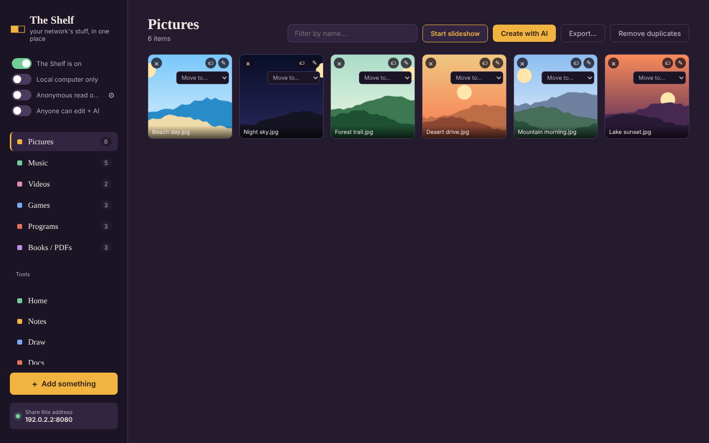

| | |
|:---:|:---:|
| 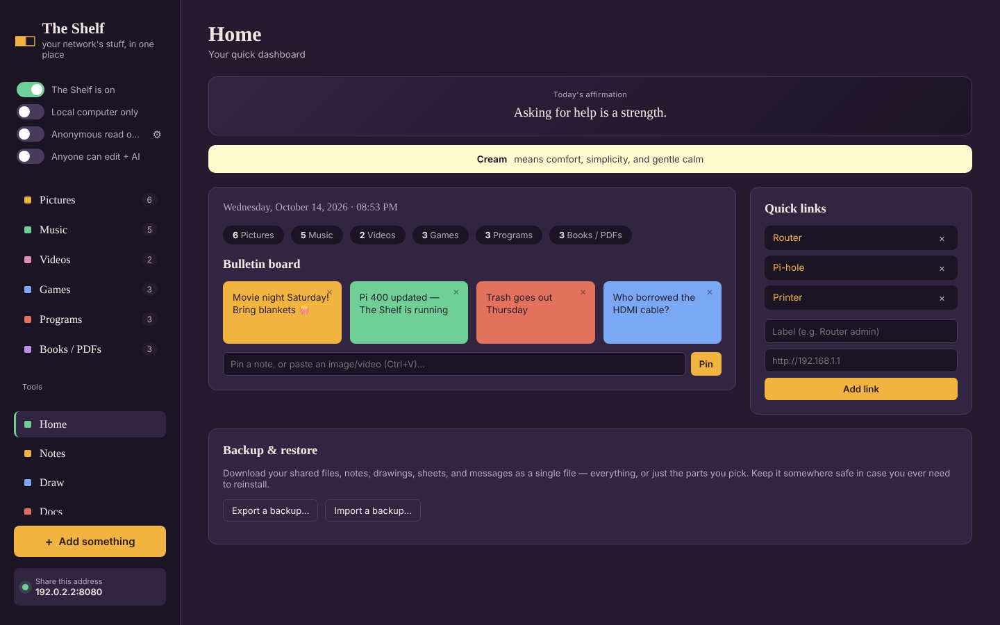 | 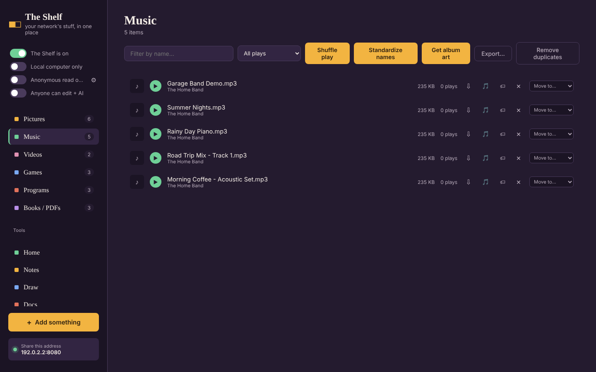 |
| **Home** — bulletin board, quick links, backup | **Music** — shuffle play, album art, play counts |
| 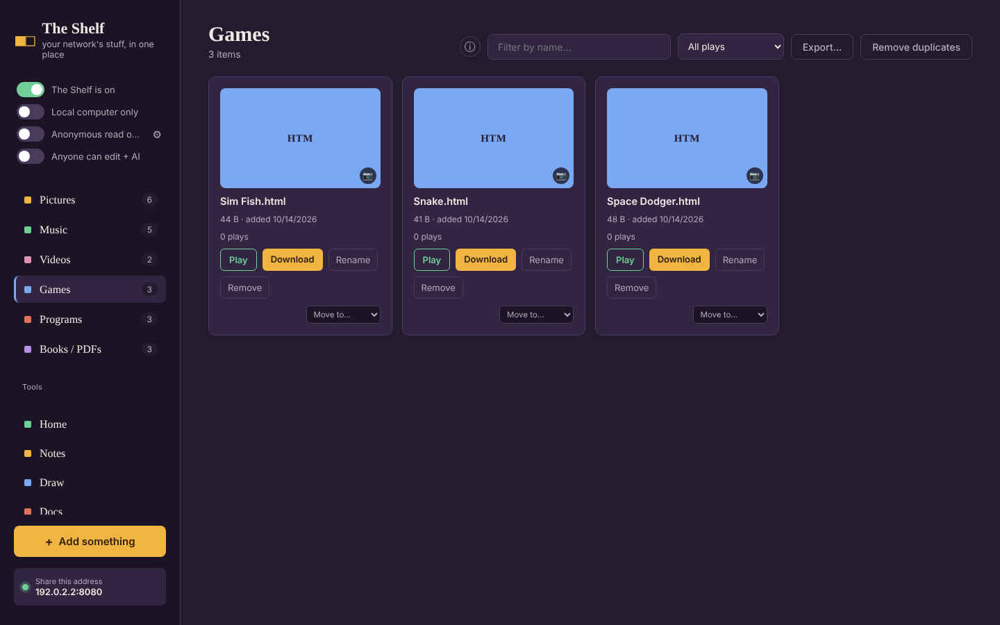 | 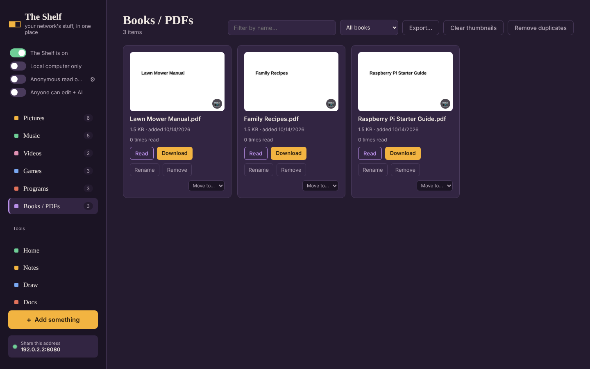 |
| **Games** — play right in the browser | **Books / PDFs** — read or download |
| 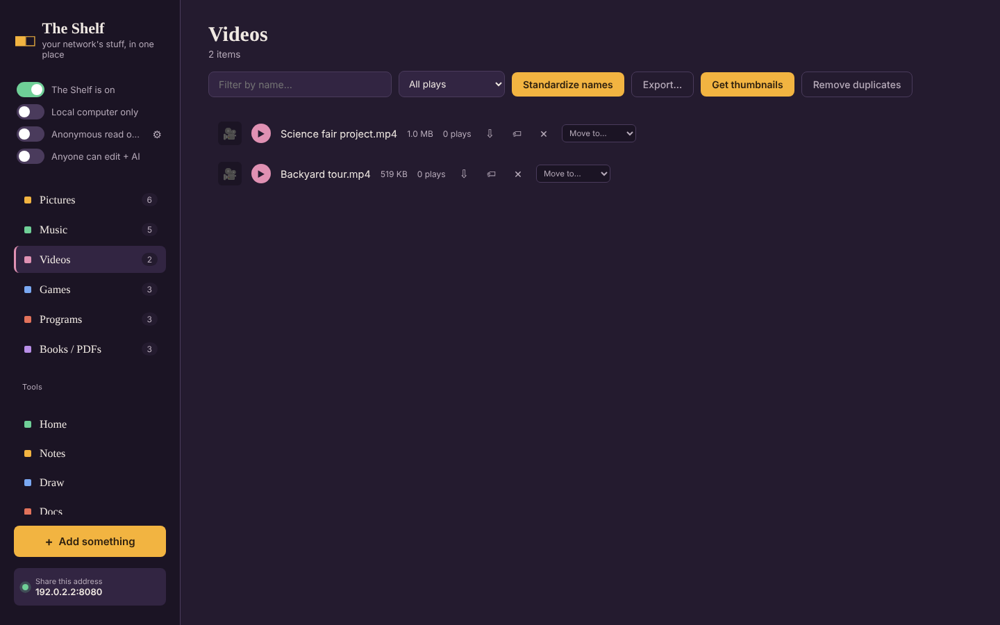 | 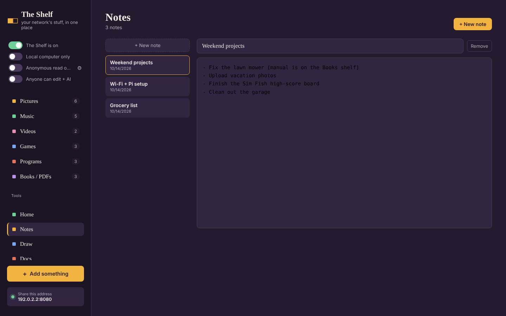 |
| **Videos** | **Notes** |
| 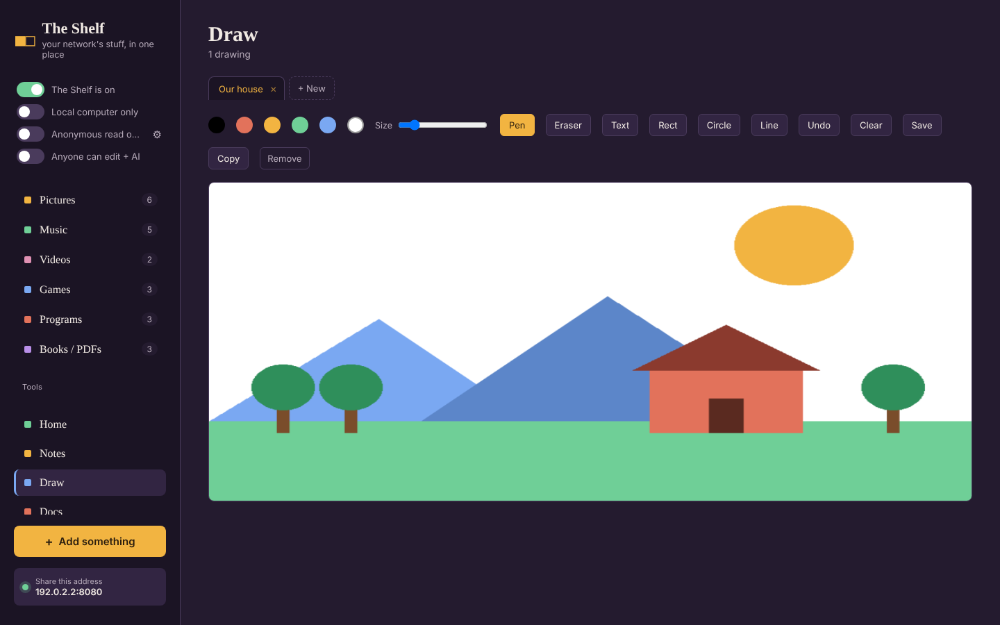 | 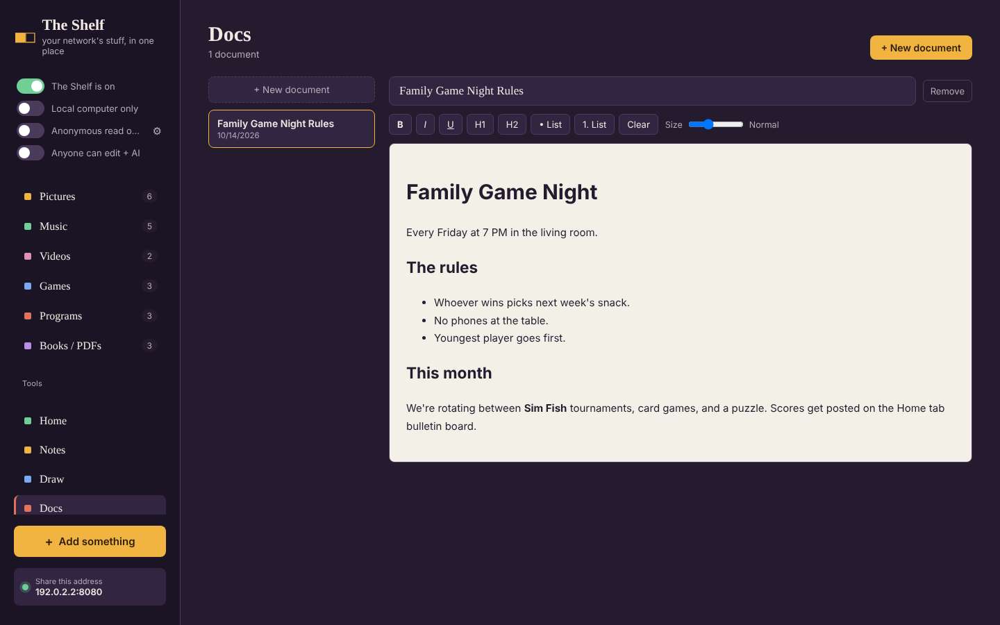 |
| **Draw** — a simple drawing pad | **Docs** — a little word processor |
| 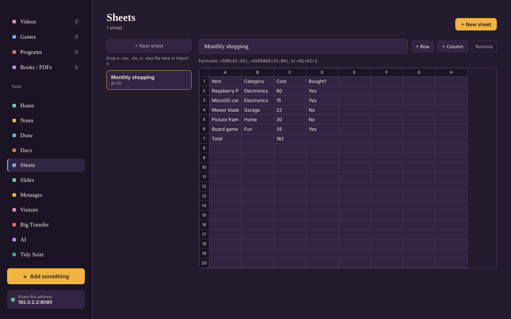 | 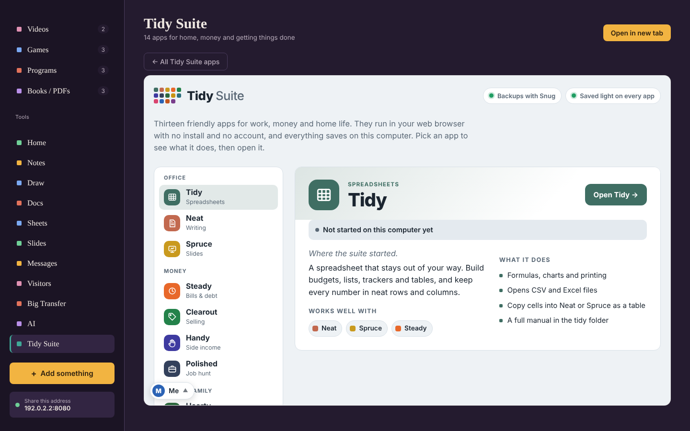 |
| **Sheets** — spreadsheet with formulas | **Tidy Suite** — home, money and life apps |

*(Screenshots use sample files — your shelf will show your own stuff.)*

## What you need

- [Node.js](https://nodejs.org) installed on the computer that will host it (the "server").
  Download the **LTS** version for your OS and install it like any other program.
  - Windows: download the `.msi` installer and run it.
  - Mac: download the `.pkg` installer and run it.
  - Linux / Raspberry Pi: see the note below — the quick `apt install` command works, but
    gives you an older Node.js than the local AI tab needs.

That's the only requirement — the same app works unchanged on Windows, Mac, Linux, and
Raspberry Pi.

**A note for Linux and Raspberry Pi:** `sudo apt install nodejs npm` (Debian/Ubuntu/Raspberry
Pi OS) is the fastest way to get Node.js, and it's all you need for sharing your files, music,
photos, notes, and everything else in The Shelf. The one thing it's *not* new enough for is the
**AI tab** — that needs Node.js 20 or newer, and Debian's own package currently installs Node
18. If you want the AI tab too (recommended — it's what makes The Shelf a great fit for a
Raspberry Pi 400), install a current Node.js instead with:

```
curl -fsSL https://deb.nodesource.com/setup_20.x | sudo -E bash -
sudo apt install -y nodejs
```

Not sure which you have? Run `node -v` — if it says `v20` or higher, you're already set. If
you skip this and try to use the AI tab anyway, The Shelf will tell you plainly what's wrong
and how to fix it, rather than failing with a confusing error.

## Setup (do this once)

**Easiest way:** open the `installer/` folder and double-click the file for your OS —
`Install (Windows).bat`, `Install (Mac).command`, or `Install (Linux).sh`. It opens a setup
page in your browser where you can pick an install location and choose whether to start The
Shelf automatically when your computer starts, then does everything below for you. Skip to
[Using it](#using-it) once that's done.

**Manual way**, if you'd rather not use the installer:

1. Unzip this folder somewhere on the host computer, e.g. `Documents/the-shelf`.
2. Open a terminal (Command Prompt/PowerShell on Windows, Terminal on Mac/Linux) in that folder.
3. Run:
   ```
   npm install
   ```
   This downloads the small set of libraries the server uses.

## Running it

In the same folder, run:
```
npm start
```
You'll see something like:
```
The Shelf is up.
  On this machine: http://localhost:8080
  On your network:  http://192.168.1.42:8080
```
- On the host computer itself, open `http://localhost:8080`.
- On any other phone/laptop/TV on the same network, open the "On your network" address shown
  in your terminal (also shown in the app's sidebar once it's running).

Leave the terminal window open — closing it stops the server. To stop it on purpose, click
the terminal and press `Ctrl+C`.

### Keeping it running in the background (optional)

- **Windows**: minimize the terminal window instead of closing it, or look into `pm2` /
  Task Scheduler for a more permanent setup.
- **Mac/Linux**: run `nohup npm start &` to keep it running after you close the terminal, or
  set it up as a `systemd` service / `launchd` agent for something that survives a reboot.
- **Raspberry Pi**: works well as a `systemd` service so it starts automatically on boot —
  search "run node app on boot systemd" for a walkthrough if you want that.

## Using it

- **Add something**: click "Add something" in the sidebar, pick which shelf it belongs on
  (Pictures / Music / Videos / Games / Programs / Books / PDFs), and drag files in or click
  to choose them. You can also drag files straight from your desktop onto a category in the
  sidebar to upload directly into it.

- **Moving files between shelves**: drag any photo, track, or file card onto a different
  category in the sidebar to move it there. On a phone or tablet (where drag-and-drop
  between elements doesn't work), use the small "Move to…" dropdown that appears on every
  item instead.
- **Renaming files**: every item on every shelf has a rename control (a tag icon on photos
  and tracks, a **Rename** button on Games/Programs cards). It prompts for a new name and
  renames the actual file on the host machine. Leave off the extension and it keeps the
  original one automatically, so typing just a new title is enough.
- **Filtering &amp; sorting**: every shelf has a "Filter by name" search box, with a small ×
  button that appears once you've typed something, to clear it in one tap. Music, Videos,
  Games, Programs, and Books also get a second dropdown with a few sort and filter options —
  **Most played** (or most downloaded/read) sorts everything by play count, highest first;
  Music also gets an **Artist (A–Z)** option that sorts alphabetically by the artist tag
  read from each file, with anything untagged sorted to the end rather than dumped at the
  top. Below those, the same never/1+/5+/10+/25+ play-count filtering as before. Both the
  search box and this dropdown work together at once.
- **Remove duplicates**: every shelf with two or more items gets a **Remove duplicates**
  button. It compares each file's actual content, not just its name, so two genuinely
  different files are never removed just because their names look similar — and conversely
  two identical files are still caught even if they're named completely differently. When it
  finds a group of identical files, it keeps the one with the shortest name (a second
  download or a copy-paste usually ends up with a "(1)" or "copy" added to the name, so the
  plain original is usually the shortest one) and deletes the rest — permanently, so it asks
  you to confirm first.
- **Pictures**: shown as a photo grid. Click any photo to open it full-screen, or click
  **Start slideshow** to auto-advance through them (adjustable seconds-per-photo, arrow keys
  to skip, Esc to close). The **Fullscreen** button inside the slideshow uses your browser's
  actual fullscreen mode, hiding the browser chrome entirely.
  - Each photo gets a slow **Ken Burns** pan/zoom while it's showing — there's a checkbox in
    the slideshow controls to turn it off if you'd rather the photos stay still. With it on,
    photos fill the frame edge-to-edge since the pan/zoom needs a fully-filled frame to look
    right; turn it off and you'll see the whole photo uncropped instead.
  - If your Music shelf has anything in it and nothing's already playing, starting the
    slideshow shuffles through your music as background audio automatically. It won't
    interrupt something you're already deliberately playing, and closing the slideshow only
    stops the music if the slideshow was the one that started it. There's a volume slider
    right in the slideshow controls — it's the same volume as the mini music player, so
    adjusting it in either place keeps both in sync — plus a skip button to jump to the next
    song without leaving the slideshow.
  - Click the pencil icon on a photo to open the **editor**: rotate, flip, and adjust
    brightness/contrast/saturation, then either **Save** (overwrites the original) or
    **Save as copy** (keeps the original untouched and adds a new file alongside it). There's
    no crop tool yet — this covers straightening, flipping, and basic color/exposure fixes.
- **Music**: click a track to play it; each track shows the artist (read from the file's own
  tag, if it has one) as a small subtitle under its name. A mini player appears at the bottom
  with its album art (if it has any), play/pause, a seek bar, a small live visualizer, a
  volume slider with mute (your volume level is remembered next time), and a close button to
  dismiss the player entirely. Double-click the little visualizer to blow it up to a real
  fullscreen view, with the same play/pause, skip, and volume controls at the bottom, plus a
  **Back** button. Click anywhere on the fullscreen
  view to cycle through six different visualization styles — bars, a mirrored waveform, a
  radial burst, a spinning kaleidoscope, a field of colored shapes that fly outward with the
  music, and a classic green oscilloscope trace of the actual waveform — double-click it (or
  hit Esc) to leave. A second slider lets you dial the bars/waveform/radial/scope styles
  anywhere between the classic orange look and a green one; it remembers your choice next
  time. Each track also has a download icon and shows how many times it's been played.
  When a track finishes, the next one in the list starts automatically; it stops after the
  last track rather than looping back to the start. A **Get album art** button in the header
  looks up cover art for any track that doesn't have it yet (searched by filename, via
  Apple's iTunes catalog — no account or setup needed) and shows it as a small thumbnail next
  to each track; hover over a thumbnail (or tap it, on a touch screen) to see it full-size —
  tap the same one again, tap a different thumbnail, or tap anywhere else to close it. The art
  is also saved directly into the file's own tag (not just The Shelf's own cache) — MP3, WAV,
  OGG, FLAC, M4A, and AAC are all supported, each using whatever tagging format is standard
  for it, so it travels with the file if it's ever copied or downloaded elsewhere. Existing
  tags like title and artist are left untouched. Tracks with no good match are just left
  without art, and running it again later only fills in the gaps rather than re-fetching
  everything. When a track has art, it also shows in the
  upper-right corner of the fullscreen visualizer. A **Clear album art** button (next to it,
  once anything's been fetched) deletes all the cached cover images so a future fetch starts
  fresh — handy if a wrong image got matched to something. An **Export list** button
  downloads the whole track list as an Excel (.xlsx) spreadsheet — name, play count, size,
  date modified, and whether it has album art — handy for keeping an offline catalog or
  sharing what's on here with someone who isn't on the network.
- **Videos**: click one to play it in a small floating player (with a download icon and a
  close button) that stays put while you keep browsing — switch tabs or scroll around and it
  keeps playing. Each video shows how many times it's been played, and finishing one
  automatically starts the next in the list, the same way Music does. A **Get thumbnails**
  button in the header grabs a real frame from each video that doesn't have one yet — this
  happens entirely in your browser (no extra software needed on the host), by briefly
  loading the video, seeking a little way in, and capturing whatever's on screen — and shows
  it as a small thumbnail next to each video, same as album art; hover to see it full-size.
  A **Clear thumbnails** button (once anything's been generated) deletes them all so a future
  run starts fresh.
- Both Music and Videos have a **Standardize names** button in the header — handy since
  files downloaded from other sites often come with messy names like
  `YTDown.com_YouTube_Song-Name_Media_abc123xyz09_001_1080p.mp4`. It cleans those up to
  just `Song Name.mp4`, renaming the actual files on the host computer. Names that already
  look normal are left alone, so it's safe to run any time — it'll just say there was
  nothing to clean up.
- **Games / Programs**: shown as cards with a **Download** button.
  - If a game is a single `.html` file, or a `.zip` containing an HTML5 game (an
    `index.html` plus its assets), a **Play** button appears — click it to run the game in a
    new browser tab, no download needed. The first time you play a zipped game it gets
    unzipped on the server (this can take a moment for bigger games); after that it's
    instant.
  - Since browsers can only upload individual files (not whole folders), zip up a game's
    folder before adding it if it has more than one file.
  - Games show a play count. Programs show a **download** count instead — there's no way
    for the app to know whether a downloaded program actually got run on your computer, so
    downloads are the closest useful stand-in.
  - Moving or renaming a file (via drag-and-drop, the "Move to…" dropdown, or a name
    collision when moving into a shelf that already has a same-named file) carries its play
    count along with it; deleting a file clears its count.
  - There's a small ⓘ button next to the "Games" / "Programs" heading that shows a short
    write-up of what The Shelf is and what it can do — handy if you're introducing it to
    someone new.
- **Books / PDFs**: for PDFs — manuals, ebooks, scanned documents, whatever. Shown as cards
  with a **Read** button that opens the PDF in a new browser tab, using the browser's own
  built-in PDF viewer (so nothing extra needs installing), rather than forcing a download
  first. Shows how many times something's been read, same idea as play counts elsewhere, and
  works with the same filtering, renaming, and moving as every other shelf.
- **Remove**: every item on every shelf — pictures, tracks, videos, games, programs, and
  books — has a small "×" or "Remove" button that deletes the file from the host computer.
  It always asks you to confirm first, since this can't be undone.

### The Tools section (sidebar)

Below the shelves, there's a second group of tabs for quick everyday tools. Everything here
saves automatically to this computer as you type — there's no separate save button to
remember (except the draw pad, which has its own Save so you control when a drawing is kept).

- **Home**: a quick dashboard — a new **affirmation** and **color of the day** (with what
  that color means) automatically every day, a quick **weather** reading for wherever you're
  browsing from, the date/time, shelf counts at a glance, a bulletin board you can pin notes
  to, a quick-links list (handy for things like your router's admin page), and a Backup &
  restore section (see below). You can also **paste an image or video** (Ctrl+V / Cmd+V)
  anywhere on this tab — a screenshot, a copied photo, a short clip — and it's pinned
  straight to the board as its own note.
  - Notes and photos stay a small, uniform size on the board so it stays tidy — hover over a
    note that's been cut off (or a photo, which is cropped to fit the tile) and the full
    content pops up next to it; tap it on a touch screen instead of hovering. Double-click
    any tile to open it in a new tab at full size — a photo or video opens at its real file
    resolution rather than the small preview, and a note opens as a plain, fully-readable
    page.
  - The affirmation and color are picked automatically from the date — nothing to post or
    maintain. They cycle through a set of about 110 affirmations and 90 colors, repeating
    every few months rather than never repeating, which keeps things fresh for years without
    needing an internet connection or ever running out.
  - **Weather is the one part of this app that needs internet access.** Your browser will
    ask permission to share your location the first time you visit Home — that location is
    sent only to this computer, which looks up the weather (via the free, no-account
    [Open-Meteo](https://open-meteo.com) service) and hands back just the temperature and
    conditions. If you say no to the location prompt, or this computer has no internet
    connection, the weather reading just quietly doesn't appear — everything else on the
    dashboard works exactly the same either way.
- **Notes**: a simple list of notes with a title and a text body. Click **+ New note** to
  start one; click any note in the list to open and edit it. Paste an image (Ctrl+V) while
  typing in a note and it's attached as a thumbnail alongside the text — click the × on it
  to remove.
- **Draw**: a tabbed drawing pad. Each tab is a separate drawing; click **+ New** to start
  another, or the small "×" on a tab to delete that drawing. Pick a color, adjust brush size,
  use the eraser, undo, or clear the canvas, then click **Save** to keep it. If you switch
  tabs (or leave Draw for another tool) with unsaved strokes, it's saved automatically first
  so nothing gets lost.
  - Picking a color doesn't change your current tool — so you can, say, switch from a red
    rectangle to a blue one without re-selecting Rect each time. Click **Pen** to explicitly
    return to normal freehand drawing from Eraser, Text, or any shape tool.
  - **Text**: click the **Text** button, then click anywhere on the canvas to type a label.
    Drag the small handle next to it to reposition before committing — press Enter to stamp
    it onto the drawing in the current color, or Esc to cancel. The brush-size slider also
    controls text size while Text is active.
  - **Shapes**: **Rect**, **Circle**, and **Line** draw from wherever you click-and-drag to
    wherever you release, with a live preview as you drag.
  - **Copy**: copies the current drawing to your clipboard as an image, so you can paste it
    into a document, note, slide, message, or the Home bulletin board — or anywhere else on
    your computer that accepts a pasted image. This needs the app open at `localhost` on the
    host computer; it won't work over the network address (`http://192.168.x.x:8080`), since
    browsers restrict clipboard access that way. If Copy doesn't work for you, use **Save**
    and paste the downloaded file instead.
  - **Paste**: the other direction also works — paste an image (Ctrl+V) from your clipboard
    straight onto the canvas. It's scaled down to fit if it's larger than the canvas, and
    centered either way; counts as a normal drawing action, so **Undo** removes it just like
    any pen stroke.
- **Docs**: a basic word processor — bold/italic/underline, headings, bullet/numbered lists,
  and a text size slider, in a simple toolbar above the page. Paste an image (Ctrl+V) and
  it's inserted inline wherever your cursor is.
- **Sheets**: a mini spreadsheet. Click a cell to type a value, or a formula starting with
  `=` — supports `=SUM(A1:A5)`, `=AVERAGE(A1:B4)`, and simple totals like `=A1+A2+3`.
  Formulas can total up plain numbers but can't reference other formulas (keeps things
  predictable). Use **+ Row** / **+ Column** to grow the grid.
  - **Import**: drag a `.csv`, `.tsv`, `.xls`, `.xlsx`, or `.ods` file onto the Sheets tab to
    bring it in as a new sheet. Only the first sheet of a multi-sheet Excel file is imported.
  - Pasting into a cell works the normal way your browser already handles it — there's no
    special image support here, since a spreadsheet cell doesn't really have anywhere for a
    picture to go.
- **Slides**: build a quick slide deck (a heading + body text per slide), then click
  **Present** to show it full-screen. Arrow keys move between slides, Esc exits. Paste an
  image (Ctrl+V) while editing a slide's heading or body and it's attached to that slide,
  shown in the editor and in Present mode too.
- **Messages**: chat with other computers running The Shelf on the same network. It finds
  them automatically — no setup, no adding contacts. Set your display name and a status
  (Online / Away / Busy / Appear offline) at the top; anyone else running The Shelf on your
  network shows up under "Online now," and clicking them starts a conversation. Messages go
  directly between the two computers (nothing passes through the internet or any third
  party), and only work while both computers are on and running The Shelf. Paste an image
  (Ctrl+V) into the message box to send it, the same way any chat app handles a screenshot.
  - This relies on network broadcast, so it only finds other installs on the **same local
    network segment** — the same Wi-Fi/switch, basically. It won't find installs across
    different networks, VPNs, or (usually) guest Wi-Fi that isolates devices from each other.
  - If a firewall prompt appears asking whether to allow the app to communicate on your
    network, allow it, or discovery and messaging won't work.
- **Visitors**: a plain list of devices that have loaded this Shelf — name (or IP address, if
  a name can't be resolved), and when they were first and last seen. This is separate from
  Messages above: it tracks anyone who's opened the app in a browser at all, not just other
  computers running their own Shelf install, so it's the one that actually fills in for the
  common case of people just browsing from their phone. Visiting from this same computer at
  `localhost` doesn't count. There's a **Clear all** button if you'd rather not keep this
  history around.

- **Tidy Suite**: all 14 Tidy Suite apps in one tab — Tidy (spreadsheets), Neat (writing),
  Spruce (slides), Steady (bills & debt), Clearout (selling), Handy (side income), Sorted
  (repairs), Hearty (meals), Ready (calendar & to-dos), Stocked (home inventory), Polished
  (job hunt), Chipper (chores & allowance), Rugged (grid-down living) and Snug (backup).
  The tab opens the suite's own dashboard; pick an app to open it right there, use
  **All Tidy Suite apps** to go back, or **Open in new tab** to give it the whole window.
  Anyone on the network gets this tab. Each person's suite work is saved in the browser they
  use it in — use **Snug** to make a backup file or move work to another device.

### Accounts & access control

By default ("Anonymous read only"), anyone on your network can open The Shelf and browse
everything, but only this machine — the one actually running The Shelf — can make changes.
Anyone connecting from another device is read-only until you set up an account for them.
There are two independent settings, both host-only (only changeable from the actual computer
running The Shelf, never over the network):

- **Accounts**: a gear icon next to the "Anonymous read only" / "Secured visitors" toggle
  (see below) opens a small panel where you create named logins, each either **Can make
  changes** or **Read only**. Anyone connecting from another device has to log in with a
  write-access account to upload, delete, rename, or edit anything — browsing still stays
  open to everyone regardless. Passwords are hashed, never stored in plain text, and this
  machine itself always has full access without logging in, since you're sitting right at
  it. You can change an account's role or password, or remove it, any time from the same
  panel. Only visible on the host computer.
- **The "Anonymous read only" / "Secured visitors" toggle**, right next to the power switch
  in the sidebar, goes a step further: switch it to **Secured visitors** and even *browsing*
  requires a login — the whole Shelf is invisible to anyone who isn't logged in from another
  device. This toggle only appears on the host machine.

Sessions are kept in memory only, not written to disk, so restarting The Shelf logs
everyone out — a reasonable, safe default.

**A note on what this is (and isn't) protecting against**: this is meant to stop casual
mistakes and unwanted changes from people on your home or office network, not to withstand
a determined attacker. The Shelf runs over plain HTTP (no certificate is set up), so avoid
using a password here that you use anywhere important.

### Turning the whole thing off

At the top of the sidebar there's a toggle labeled "The Shelf is on." Switching it off turns
off the whole app for everyone on your network — anyone who visits sees a simple "turned off"
page instead of your shelves, and it asks you to confirm before doing this. The app itself
keeps running quietly in the background the whole time, so switching it back on (from that
same "turned off" page, or the toggle if you still have the sidebar open) works instantly —
no restart needed. This setting is remembered, so if the computer restarts while it's off,
it'll come back up off too, until someone switches it on again.

### Backup & restore

On the Home tab there's a **Backup & restore** section. **Export a backup** downloads a
single `.zip` with everything — your shared files, notes, drawings, sheets, presentations,
and messages. Keep it somewhere safe (a USB drive, cloud storage, wherever) — if you ever
need to reinstall, wipe your computer, or move to a new one, use **Import a backup** on the
fresh install to bring everything back.

Importing **replaces** everything currently on that install, so it asks you to confirm
first. After a successful import, restart The Shelf (stop it and run `npm start` again) so
everything loads correctly.

- This only works for devices on the **same local network** (same Wi-Fi/router) unless you
  do extra router configuration (port forwarding) — which isn't necessary or recommended for
  a home setup like this.
- There's no login by design, to keep it simple — anyone on your network can see and add
  files. If that's a concern, only run it while you're actively sharing something, or ask if
  you'd like help adding a simple password.
- Uploaded files are stored in the `shared/` folder inside this project, sorted into
  `Pictures/`, `Music/`, `Videos/`, `Games/`, and `Programs/` subfolders — you can also just
  drop files directly into those folders from the host computer and they'll show up in the
  app.
- Zipped games get unzipped into a hidden `shared/.extracted/` folder the first time they're
  played. This is cleaned up automatically if you remove or move the zip, so you don't need
  to manage it yourself.

### Connecting to another computer (Shelf or VNC)

In **Messages**, click anyone in the list and choose:

- **Message** — chat, as before.
- **Connect Shelf** — opens their Shelf in a new browser tab.
- **Connect VNC** — opens their desktop in a new tab, so you can see and control it from the
  browser (works from a phone too). That computer needs a VNC server turned on:
  - Raspberry Pi: `sudo raspi-config` → Interface Options → VNC → Enable.
  - Mac: System Settings → General → Sharing → Screen Sharing.
  - Windows: install a VNC server such as TightVNC or RealVNC Server.

The browser can't speak VNC itself, so The Shelf on the computer you're browsing passes the
connection through to the other computer's VNC port (5900–5999). The VNC login goes straight
to that computer and is never stored. Only the host computer, or someone allowed to make
changes on this Shelf, can use it, and only to computers in the Messages list.

**One limit:** the Raspberry Pi's default encrypted VNC login, and Mac Screen Sharing, need
the browser's built-in encryption — which browsers only allow on secure pages. They work when
you open The Shelf on the host computer itself; from a phone or another computer (a plain
`http://` page) they can't be used, and the VNC tab says so. A standard **VNC password** login
works from anywhere (on RealVNC Server: Options → Security → Authentication → VNC password,
Encryption → Prefer off), or use the tab's **Open in a VNC app instead** button.

## Changing the port

By default it runs on port `8080`. If that's already in use on your machine, run it on a
different port instead:
```
# Mac/Linux
PORT=9000 npm start

# Windows (PowerShell)
$env:PORT=9000; npm start
```

The Messages tool also uses a fixed network port (`41234`, UDP) to find other installs —
this isn't currently configurable. If two people on the same network both change their
`PORT` for the web app, discovery between them still works fine since it's separate from
that.

## About the installer

The `installer/` folder is a small Node script with a real settings page — it's not a
compiled `.exe`/`.dmg`/`.pkg`, since building those properly requires platform-specific tools.
What it actually does when you run it:

1. Opens a page in your browser where you choose an install location and whether to start
   automatically on login.
2. Copies the app to that location (if you reinstall over an existing install, your own
   files/notes/drawings in `shared/` and `data/` are left untouched — only the app code is
   updated).
3. If you checked the autostart box, it writes one small OS-native file:
   - **Windows**: `TheShelf.vbs` in your Startup folder
   - **Mac**: `~/Library/LaunchAgents/com.theshelf.app.plist`
   - **Linux**: `~/.config/autostart/theshelf.desktop`
4. Starts the app right away.

**To turn off autostart later**, either delete the file above for your OS, or run the
installer again with the box unchecked — it'll remove it for you.

**If it seems stuck on "Installing…"**: the file-copy step can genuinely take a minute or
two on Windows if antivirus software scans each file as it's copied — the terminal window
behind the setup page shows live progress, so check there first. The page itself will also
update its message after a few seconds, and gives up with a clear error after 4 minutes if
something is actually stuck rather than just slow.

**If you're re-running the installer to upgrade**: it checks whether an old copy of The
Shelf is still running on the port it needs, asks it to close, waits until the port is
actually free, and then starts the new version — one click, even with The Shelf open in a
browser tab. It will never touch an unrelated program — if something else is using that
port, it tells you instead of guessing. If the old copy was started as a system service
(for example with `systemd` and `sudo`), the installer isn't allowed to stop it; it says so,
and restarting that service (or the computer) brings up the new version.

(Older versions of the installer could stop *themselves* partway through an upgrade on
Linux and Mac — they closed everything connected to the port, not just the old server —
which is why an upgrade sometimes needed the Install button clicking twice.)

**If the page shows "Failed to fetch"**: this means the setup process itself stopped
running mid-install — the terminal window behind the page will show what happened. If it
keeps happening, the terminal's error message is the important part to share when asking
for help.
